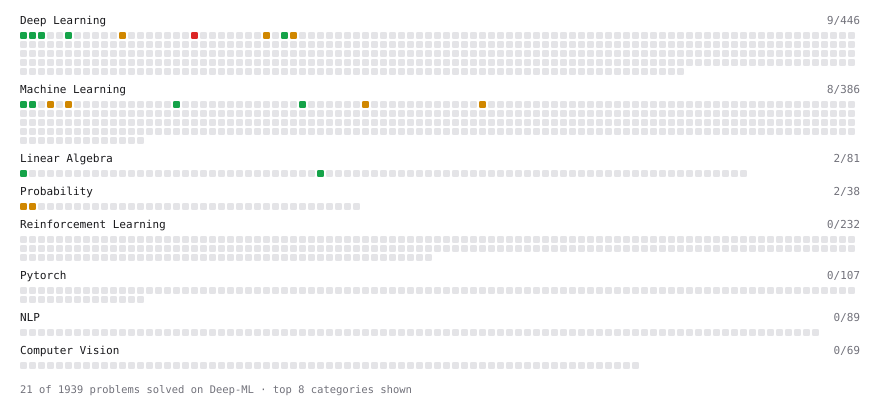

# Deep-ML

My machine learning practice from [Deep-ML](https://www.deep-ml.com). Every solution here was written by hand.

**23** solved · 23 problems · 0 labs · 0 math

[**Browse the interactive portfolio**](https://echen1214.github.io/deep-ml/) to replay this filling in over time.

## Problems

| | Difficulty | Solved | |
| --- | --- | --- | --- |
| [Calculate F1 Score from Predicted and True Labels](https://www.deep-ml.com/problems/91) | easy | 2025-11-26 | [solution](problems/0091-calculate-f1-score-from-predicted-and-true-labels) |
| [Implement Global Average Pooling](https://www.deep-ml.com/problems/114) | easy | 2025-04-09 | [solution](problems/0114-implement-global-average-pooling) |
| [Implementation of Log Softmax Function](https://www.deep-ml.com/problems/39) | easy | 2025-04-09 | [solution](problems/0039-implementation-of-log-softmax-function) |
| [Linear Kernel Function](https://www.deep-ml.com/problems/45) | easy | 2025-04-10 | [solution](problems/0045-linear-kernel-function) |
| [Linear Regression Using Gradient Descent](https://www.deep-ml.com/problems/15) | easy | 2025-04-10 | [solution](problems/0015-linear-regression-using-gradient-descent) |
| [Linear Regression Using Normal Equation](https://www.deep-ml.com/problems/14) | easy | 2025-04-10 | [solution](problems/0014-linear-regression-using-normal-equation) |
| [Matrix Determinant & Trace](https://www.deep-ml.com/problems/195) | easy | 2025-11-11 | [solution](problems/0195-matrix-determinant-trace) |
| [Matrix-Vector Dot Product](https://www.deep-ml.com/problems/1) | easy | 2025-04-07 | [solution](problems/0001-matrix-vector-dot-product) |
| [Sigmoid Activation Function Understanding](https://www.deep-ml.com/problems/22) | easy | 2025-04-09 | [solution](problems/0022-sigmoid-activation-function-understanding) |
| [Single Neuron](https://www.deep-ml.com/problems/24) | easy | 2025-04-09 | [solution](problems/0024-single-neuron) |
| [Softmax Activation Function Implementation ](https://www.deep-ml.com/problems/23) | easy | 2025-04-09 | [solution](problems/0023-softmax-activation-function-implementation) |
| [Binomial Distribution Probability](https://www.deep-ml.com/problems/79) | medium | 2025-11-13 | [solution](problems/0079-binomial-distribution-probability) |
| [Implement Batch Normalization for BCHW Input](https://www.deep-ml.com/problems/115) | medium | 2025-04-09 | [solution](problems/0115-implement-batch-normalization-for-bchw-input) |
| [Implement K-Nearest Neighbors](https://www.deep-ml.com/problems/173) | medium | 2025-11-28 | [solution](problems/0173-implement-k-nearest-neighbors) |
| [Implement Layer Normalization for Sequence Data](https://www.deep-ml.com/problems/109) | medium | 2025-12-03 | [solution](problems/0109-implement-layer-normalization-for-sequence-data) |
| [Implement Masked Self-Attention](https://www.deep-ml.com/problems/107) | medium | 2025-12-03 | [solution](problems/0107-implement-masked-self-attention) |
| [Implement Self-Attention Mechanism](https://www.deep-ml.com/problems/53) | medium | 2025-12-02 | [solution](problems/0053-implement-self-attention-mechanism) |
| [K-Means Clustering](https://www.deep-ml.com/problems/17) | medium | 2025-04-14 | [solution](problems/0017-k-means-clustering) |
| [Normal Distribution PDF Calculator](https://www.deep-ml.com/problems/80) | medium | 2025-11-13 | [solution](problems/0080-normal-distribution-pdf-calculator) |
| [Principal Component Analysis (PCA) Implementation](https://www.deep-ml.com/problems/19) | medium | 2025-04-12 | [solution](problems/0019-principal-component-analysis-pca-implementation) |
| [Simple Convolutional 2D Layer](https://www.deep-ml.com/problems/41) | medium | 2025-12-04 | [solution](problems/0041-simple-convolutional-2d-layer) |
| [Implement Multi-Head Attention](https://www.deep-ml.com/problems/94) | hard | 2025-12-02 | [solution](problems/0094-implement-multi-head-attention) |
| [Positional Encoding Calculator](https://www.deep-ml.com/problems/85) | hard | 2025-12-04 | [solution](problems/0085-positional-encoding-calculator) |

---

_This file is regenerated by Deep-ML on every push._
